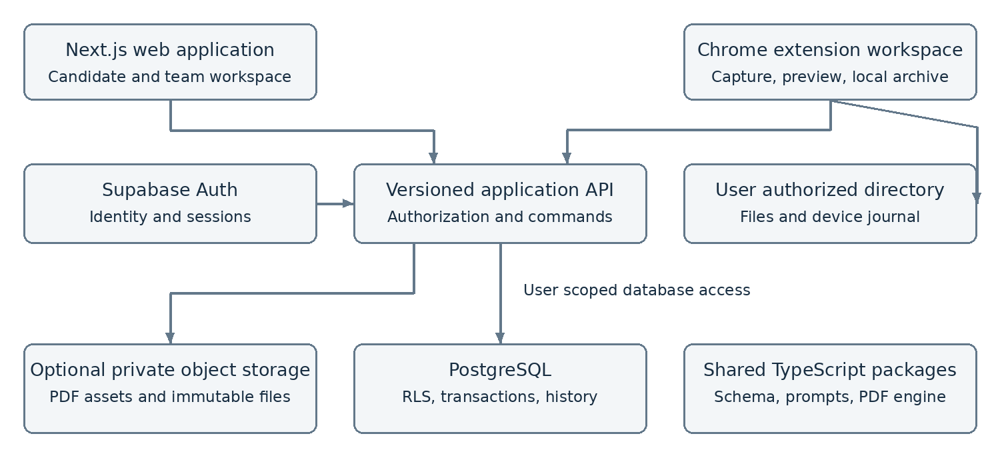

<!-- Source transcription: doc/Candidate_Platform_Design_Document.docx, version 1.0, 17 October 2026. -->
<!-- Source paragraphs, all 21 tables, code examples, figure, requirements, proposed defaults, and open decisions are preserved. Word page layout and repeating page-number footer are omitted. -->

# Candidate Management Resume Studio and Bid Operations Platform

> Source: [original design document](../doc/Candidate_Platform_Design_Document.docx). This transcription preserves the proposed design; it does not approve its defaults or resolve requirement conflicts. See the [comparison and decision register](BUILD_PLAN.md#requirements-comparison-and-decision-register).

Implementation branding: **Application Tracker v2**. The repository/folder remains `ApplicationTracker_v2`; the original source title below is retained as historical design context.

**Technical Design Document**

Version 1.0  |  17 October 2026  |  Proposed design

For product owners, engineering, quality assurance, and operations

### Design intent

Build a shared candidate and submission system with two clients: a web workspace for authoritative records and team operations, and a Chrome extension for job capture, prompt assembly, resume preparation, and local bid packages. Both clients use the same authorization rules, content contracts, and versioned backend.

The recommended foundation is a TypeScript monorepo, a Next.js application API, Supabase Auth and PostgreSQL, and a browser-based document engine. Start with one organization, but enforce an organization boundary in every business record. Keep local files, database synchronization, and submission status independent.

### What this document specifies

- System boundaries, permissions, relational entities, and API contracts.

- Resume validation, prompt composition, template versions, preview, and PDF generation.

- Bid approvals, interview rounds, duplicate detection, and recoverable local archiving.

- Deployment structure, verification gates, release phases, and decisions requiring product confirmation.

### Delivery boundary

This is an engineering design for the supplied version 1.0 requirements, including Quick Application Check and Local Bid Archive. It defines proposed implementation defaults and release gates; it is not a claim that the application, security controls, or browser integrations have been implemented or tested.

## Document guide

Sections progress from architecture and access controls to data contracts, user workflows, and delivery. Product owners should review the defaults in Section 1 and the decisions in Section 24 before development starts. Engineers should use the API, schema, and transaction sections as the basis for implementation tickets.

 1    Scope and design decisions

 2    Architecture and trust boundaries

 3    Application experience

 4    Identity and permissions

 5    Authorization enforcement

 6    Candidate and configuration data

 7    Workflow and document data

 8    Integrity and database transactions

 9    Application API

10    Operation and error contracts

11    Canonical resume schema

12    Prompt and factual validation

13    Templates and the PDF engine

14    Browser extension design

15    Application history matching

16    Local archive structure

17    Save orchestration and recovery

18    Bid state and approval design

19    Interviews and operational reporting

20    Security and service operations

21    Repository and deployment

22    Verification and acceptance

23    Implementation plan

24    Open decisions and risk controls

25    Technical references

### Design conventions

MUST denotes a release requirement. Proposed default denotes a choice made here where the requirements allow alternatives. Identifiers are UUIDs unless stated otherwise. Times are stored in UTC with IANA time zone names retained where user intent depends on local time. API examples are contracts, not deployable code.

## 1 Scope and design decisions

The first release should provide a complete controlled workflow from candidate profile through resume generation, draft bid preparation, submission recording, and interview tracking. Use manual copy and paste with an external AI tool initially; no paid model API integration is required.

| Area | Proposed default | Reason |
| --- | --- | --- |
| Application boundary | Next.js web app and API; Chrome MV3 extension | One backend contract for both clients. |
| Persistence | Supabase PostgreSQL and Auth | Managed identity with relational transactions and RLS. |
| Organization model | One initial organization with explicit organization_id | Prevents accidental cross-organization access as the product grows. |
| PDF engine | Shared pdf-lib renderer and PDF.js preview | Preview the same PDF bytes that will be saved. |
| Local archive | Directory handles in a full extension page | Supports real folder inspection inside a user-authorized root. |
| Workflow approval | Required by default; configurable by team | Make submission control explicit and traceable. |
| Documents | Immutable versions and optional PDF uploads | Preserves content and the exact version submitted. |
| Hosting | Managed Next.js host plus Supabase | Avoids an always-running local server. |

### Scope boundaries

In scope: all ten authenticated navigation areas; four roles; candidate records; eight to ten built-in templates; prompt assembly; resume and cover letter versions; bids; interviews; follow-ups; in-app notifications; and extension history checking with local package recovery.

Deferred: automatic job submission, automatic AI API generation, email and messaging integrations, arbitrary executable templates, unrestricted filesystem access, browser store publication, and the native Windows helper. These require separate implementation and release decisions.

### Clarifications resolved in this design

- A bid means one candidate application to one job opportunity, not a commercial proposal.

- Phone is optional. Draft profiles may be incomplete; Ready profiles require a name, valid email, and usable location information. Do not create placeholder facts to satisfy completeness checks.

- Bidders may archive an already authorized prepared document. They cannot create or alter resume content unless an explicit resume-generation capability is granted.

- Saving a package never marks a bid Submitted. Unknown history or denied directory access never means no previous application.

## 2 Architecture and trust boundaries



*Figure 1  Shared backend with a separate local archive boundary*

The web and extension call /api/v1 on the same application service. The API authenticates requests, resolves current membership, validates inputs, and executes database queries or transactional commands. The extension receives no database administrator credential. Shared packages are build-time dependencies used in both clients, not another network service.

| Component | Responsibilities |
| --- | --- |
| Web client | Navigation, role-specific dashboards, profile editing, Resume Studio, team administration. |
| Extension workspace | User-triggered capture, candidate context, JSON editor, PDF preview, directory permissions, persistent operation journal. |
| API and domain services | Authorization, field projection, canonicalization, version creation, transition rules, audit events, idempotency. |
| PostgreSQL | Foreign keys, tenant isolation, RLS, immutable versions, status history, unique operation keys. |
| Optional storage | Private PDFs and versioned assets; access through short-lived authorized retrieval. |
| Client document engine | Validated content and snapshot to layout plan, PDF bytes, hashes, preview, and export. |

### Trust model

Webpage text, job descriptions, pasted JSON, local metadata, extension messages, and caller-supplied IDs are untrusted. The server derives user identity and verifies organization membership. It never treats local status claims as proof of submission. Local files are user-controlled copies and are not protected by server RLS after export.

RLS is a second authorization boundary. Normal API database calls use the authenticated user context. Administrative identity operations use a narrowly isolated server-only credential after explicit permission checks and audit logging. Route handlers require their own checks [1, 2].

## 3 Application experience

Use a persistent application shell with organization and team context, permission-filtered navigation, search, notifications, and a user menu. Each list preserves filters in the URL. The server applies the same scope to lists, totals, exports, and detail requests.

| Workspace | Primary interaction | Required states |
| --- | --- | --- |
| Dashboard | Open approval queues, follow-ups, interviews, failed operations | Loading, empty, partial data, stale data, scoped totals. |
| Candidates | Search and filter; open Overview, Profile, Resumes, Bids, Interviews, Activity | Unassigned, incomplete profile, archived, permission changed. |
| Bids | Table or board by status; create, prepare, review, submit | Duplicate warning, version conflict, missing documents. |
| Interviews | Agenda and bid-specific rounds; schedule, feedback, outcome | Time zone ambiguity, pending feedback, cancelled round. |
| Resume Studio | Template library, PDF preview, JSON editor in a 3–6–3 desktop grid | Invalid JSON retained, render pending, stale preview, save results. |
| Templates and Prompts | Scope-aware search, duplicate, edit, publish version, reset | Read-only global content, draft, published, archived. |
| Team and Settings | Assignments, memberships, capabilities, approval defaults | Restricted action, concurrent change, deactivated account. |
| Notifications | Open record, mark read, filter due and failed operations | Unavailable record after access revocation. |

### Resume Studio interaction

At wide desktop widths, use the required 12-column 3–6–3 arrangement. At smaller widths, switch to Template, Preview, and JSON tabs; keep validation and export actions reachable. Template thumbnails are generated from one sample snapshot. The center displays paginated PDF bytes with zoom and page controls. Content edits mark the preview stale until a new validated render completes.

The editor retains raw input through validation failures. Format JSON is available only after parsing succeeds. Clear asks before discarding unsaved work. Save Source creates a version without claiming that a PDF exists. Generate PDF exposes validation, generation, local saving, and synchronization as separate rows.

### Accessibility and navigation

Use semantic landmarks, visible keyboard focus, labeled fields, error summaries that link to inputs, and text labels alongside status colors. Provide an accessible text view for the resume beside the PDF preview. Dangerous actions use clear consequences; routine saves preserve focus and announce results. Public pages expose no operational counts or candidate data.

## 4 Identity and permissions

Supabase Auth owns identity. Application tables own organization membership, account activation, team roles, and resource assignments. Resolve permissions from current database state for every protected request; a role displayed in the client or held in an old token is not sufficient authorization.

| Capability | Admin | Leader | Member | Bidder |
| --- | --- | --- | --- | --- |
| Manage users and roles | Organization | No | No | No |
| Read candidate profile | Organization | Team | Assigned | Bid projection |
| Edit candidate profile | Organization | Team | Assigned | No |
| Assign candidates | Organization | Own team | No | No |
| Create or edit bids | Organization | Team | Assigned | Authorized bids |
| Approve submissions | Organization | Team | No default | No default |
| Manage interviews | Organization | Team | Assigned | No |
| Generate resumes | Yes | Team | Assigned | No default |
| Read document history | Organization | Team | Assigned | Linked bid only |
| Manage global defaults | Yes | No | No | No |
| View analytics | Organization | Team | Assigned | Own bids |

### Scope rules

Admin means an administrator of the current organization. A leader can operate only within teams where they have an active leader membership. A member needs an active candidate assignment and active membership in its team. A bidder needs an explicit bid grant or a candidate bid-preparation grant; ownership alone cannot bypass organization or assignment checks.

Use named capabilities such as candidate.edit, bid.prepare, bid.approve, bid.submit, interview.manage, resume.generate, document.read, and document.export. Role templates supply defaults. Any capability override must name an allowed scope, be granted by an administrator, and be audited. A capability never expands the resource scope by itself.

### Session behavior

The web uses a server-managed session with Secure, HttpOnly, SameSite cookies and CSRF protection for mutations. The extension uses a short-lived bearer token obtained through a supported sign-in flow. Deactivation or reassignment takes effect through current membership checks, even while a token remains cryptographically valid. Expired sessions pause synchronization without discarding saved local files.

## 5 Authorization enforcement

### Database access pattern

Enable RLS on every business table, including versions, history, assignments, notifications, and audit records. Explicitly revoke unintended grants and define SELECT, INSERT, UPDATE, and DELETE policies separately. Normal API reads run as the user. Revoke direct writes to protected workflow and permission fields; all version records are append-only. Critical writes use reviewed database command functions so validation, history, and mutation occur in one transaction [1].

Keep permission helpers in a private schema. Protected mutation commands use SECURITY DEFINER functions owned by a dedicated NOLOGIN, NOBYPASSRLS role that does not own the tables. Grant that role only required mutations and apply RLS policies that check the current auth.uid() and scope. Each function also checks capability, pins search_path, qualifies relations, and forbids dynamic SQL. Revoke PUBLIC execute and grant only named commands to authenticated users. Invoker functions serve ordinary permitted reads. Never accept created_by or organization_id as trusted identity. Helpers must avoid recursive membership policies.

### Bidder field protection

RLS filters rows, not the permitted business meaning of every column. Deny bidder access to raw candidate profile and profile-history rows. Provide a narrow, authorization-checking read function returning identity, permitted contact details, approved professional summary, and bid-linked document references. Exclude private notes, unrelated bids, other team activity, and interview feedback.

All roles share Supabase’s authenticated database role, so column grants alone cannot distinguish application roles. Use separate safe relations or constrained read functions with application-role checks. If using views, explicitly evaluate their security behavior; default view ownership can bypass RLS [1].

| Resource | Read boundary | Write boundary |
| --- | --- | --- |
| Candidate and children | can_read_candidate or safe bidder projection | can_edit_candidate; immutable organization and candidate links. |
| Bid and history | can_read_bid; no hidden candidate-wide expansion | can_prepare_bid; transitions only through command function. |
| Resume and letter versions | Authorized candidate or explicit bid linkage | Append via generation capability; no client update or delete. |
| Interview and feedback | can_manage_interview scope; no bidder access | Scoped command; bid and candidate consistency. |
| Assignments and roles | Scoped membership projection | Admin or leader within own team; no self-escalation. |
| Audit and notifications | Audience-specific projection or recipient | System writes; recipient can change read state only. |

### Reassignment and revocation

Changing candidate ownership does not silently move every historical bid to another team. Candidate scope and bid team remain explicit. An administrator transfers records in an audited transaction when required. Revalidate access before every retry or file retrieval. Previously exported local files cannot be remotely revoked; the UI must state this in export and offboarding guidance.

## 6 Candidate and configuration data

All business entities carry organization_id. Use UUID primary keys, created_at and updated_at timestamps, created_by where relevant, and row_version on mutable aggregates. Store optional or unknown draft facts as null, not invented values. Child tables reference both organization and parent IDs through composite foreign keys.

| Entity | Principal fields | Rules |
| --- | --- | --- |
| organizations | id, name, status, default_timezone | Initial deployment may contain one organization. |
| users and organization_memberships | auth_user_id, display_name; organization_id, role, active | No passwords in application tables; unique organization and user membership. |
| teams and team_memberships | team_id, user_id, role, active, approval_policy | Team belongs to one organization; role restricted to allowed team roles. |
| candidates | owning_team_id, full_name, email, phone, location, seniority_preference, status, row_version | One owning team; archive instead of routine delete; Ready requires name, email, location. |
| candidate_assignments | candidate_id, team_id, user_id, assignment_kind, active_from, ended_at | End old assignment and append new assignment; preserve history. |
| work_experiences | company, official_title, dates, location, source_bullets, achievements, title_policy, approved_display_title, sort_order | Store date precision; no fabricated day for month-only data. |
| educations and certifications | institution, degree, field, period, display_policy; issuer, issue_date, expiry, verification_status | Optional unknown periods; expiration must follow issue date when both known. |
| candidate_links | candidate_id, link_type, url, display_order | Normalize URL; allow only approved schemes. |
| candidate_profile_revisions | candidate_id, revision_number, verified_snapshot, changed_by | Immutable snapshot and provenance for generation and comparison. |
| prompt_presets and prompt_versions | scope, scope_id, name; version, content, enabled, order, protected | One active main prompt per organization; append on publication. |
| resume_templates and template_versions | scope, owner, name; version, layout_json, asset_hashes, renderer_contract | No HTML or executable scripts in template definitions. |

### Profile editing semantics

Profile updates validate all modified child entries in one transaction and increment the candidate aggregate version. Reorder requests submit ordered IDs already belonging to the candidate. Overlapping employment dates are warnings; impossible date ordering is an error. Removal from a current profile never rewrites existing document snapshots.

## 7 Workflow and document data

| Entity | Principal fields | Rules |
| --- | --- | --- |
| companies and company_aliases | display_name, canonical_key, verified_domain; alias_key, verified_by | Organization-scoped identity; ambiguous aliases need review. |
| bids | candidate_id, team_id, owner_id, company_id, company_name, job_title, job_description, priority, status, outcome, row_version | Independent job opportunity; explicit submitted_at and next_follow_up_at. |
| bid_job_identifiers | bid_id, provider, external_job_id, canonical_url, jd_hash, normalization_version | Indexed identifiers; possible matches do not imply a merge. |
| bid_access_grants | bid_id or candidate_id, user_id, capability, expires_at | Exactly one grant target; validate target, organization, scope, and expiry. |
| bid_status_history and bid_approvals | from_status, to_status, actor, reason; exact document version IDs, revision hash, decision | Append-only; approval invalidated by changes to reviewed content. |
| bid_submissions | bid_id, submitted_at, actor, confirmation, resume_version_id, cover_letter_version_id | Immutable submitted package references; resubmission is another event. |
| interviews and interview_feedback | bid_id, round, type, scheduled_at, timezone, meeting details, lifecycle_status; feedback, outcome, next_action | Rounds belong to bid; derive candidate through bid. |
| resume_versions | candidate_id, profile_revision_id, bid_id optional, raw_json, parsed_json, schema_version, template_version_id, renderer_version, provenance | Immutable content plus identity and presentation snapshots. |
| cover_letter_versions | candidate_id, bid_id, body_text, version, content_hash | Append-only; old submitted letters remain available. |
| documents | resume or letter version ID, pdf_hash, byte_size, page_count, font_hashes, storage_key optional | One content version may have distinct recorded render artifacts. |
| archive_operations and device_archives | operation_id, request_hash, result_ids, sync_state; device_id, operation_id, relative_path, local_state, checked_at | Separate server transaction result from device-reported local state. |
| tasks and notifications | subject_type, subject_id, assignee, due_at, state; recipient, event_key, read_at | Permission-aware; deduplicate reminder events. |
| audit_logs | actor, action, subject_id, organization_id, request_id, time, redacted_change_summary | Append-only; clients cannot manufacture audit events. |

Store selected current draft document references on a bid for convenience. Historical submission and approval records retain the exact versions they used. Do not store mutable resume_json on both bids and resume_versions; archive API payloads are normalized into one canonical version record.

## 8 Integrity and database transactions

### Required constraints and indexes

- UNIQUE (organization_id, id) on tenant-owned parents, with matching composite foreign keys on children. Candidate, bid, template, and version links must belong to the same organization.

- UNIQUE (organization_id, operation_id) for synchronization. Persist actor, operation type, request_hash, and result IDs. Reject another actor/type or changed payload; reauthorize before replay.

- UNIQUE (candidate_id, revision_number), (template_id, version), (prompt_id, version), and (bid_id, round_number). Allocate versions under a parent row lock or equivalent database control.

- Check that resume and cover letter versions referenced by a bid belong to its candidate. Restrict deletion of referenced versions. Keep ordinary archival separate from an approved purge.

- Index bids by (organization_id, candidate_id, company_id, created_at DESC), (organization_id, team_id, status), (owner_id, next_follow_up_at), and each job identifier used for matching.

- Index active memberships and assignments used by RLS, interviews by scheduled_at and bid_id, notifications by recipient and read state, and audit logs by organization and timestamp.

### Concurrency contract

Mutable aggregates return an ETag derived from row_version. PATCH and transition commands require If-Match. Update with WHERE row_version = expected; return 409 VERSION_CONFLICT when no eligible row changed. The response exposes the current authorized version so the user can compare and retry. Never overwrite concurrent edits silently.

### Atomic commands

| Command | Work committed together |
| --- | --- |
| update_candidate | Verify scope and expected version; edit profile and child rows; append profile revision and audit event. |
| change_assignment | Check leader or admin authority; close prior assignment; add new assignment; invalidate affected access; log change. |
| save_bid_package | Acquire operation key; verify content and scope; resolve duplicate intent; create or reuse draft bid; append document versions; store result; log event. |
| transition_bid | Lock bid; check role, state, version, approval, required fields; append submission or decision; update bid; append status history and audit. |
| record_interview_result | Verify bid scope; update lifecycle and append feedback; create next action; optionally execute an explicit permitted bid transition. |

All statements of one command execute inside a database function or one server transaction. Separate REST calls do not form a transaction. A document package synchronization commits fully or rolls back. Filesystem writes and database transactions cannot share atomic commit; Section 17 defines their recovery protocol.

## 9 Application API

Use /api/v1 and a checked-in OpenAPI contract. Web requests authenticate by session; extension requests use Bearer tokens. JSON payloads use camelCase, while database columns use snake_case. Lists use opaque cursor pagination and a proposed maximum of 100 records. All responses contain requestId; personal data responses use Cache-Control: no-store.

| Method and route | Purpose | Control |
| --- | --- | --- |
| GET /me | Identity, active organization, capabilities, authorized scopes | Current membership; no client-assigned roles. |
| GET or POST /candidates | Scoped directory or new candidate | Read projection or candidate.create. |
| GET or PATCH /candidates/{id} | Read or update profile and children | Edit capability and If-Match. |
| POST /candidates/{id}/assignments | Assign or transfer within team scope | Leader or admin; audited. |
| GET /prompts and /templates | Published definitions and authorized drafts | Scope-filtered. |
| POST /prompts/{id}/versions and /templates/{id}/versions | Publish immutable configuration | Scoped edit capability. |
| POST /prompt-assemblies | Exact prompt text, version IDs, profile revision, hash | resume.generate; authorized profile. |
| POST /resume-validations | Schema and factual comparison result | Authorized candidate; no persistence required. |
| POST /resume-versions | Save validated source and snapshots | resume.generate; idempotency key. |
| POST /cover-letter-versions | Append a letter version | Document preparation capability. |
| GET or POST /bids | Scoped bids or new draft | bid.prepare; duplicate intent handling. |
| PATCH /bids/{id} | Edit permitted draft fields | If-Match; restricted field allowlist. |
| POST /bids/{id}/transitions | Status, approval, or submission command | Allowed transition and capability. |
| GET or POST /bids/{id}/interviews | List or create rounds | interview.manage scope. |
| PATCH /interviews/{id} | Schedule, feedback, outcome, next action | If-Match; bidder denied. |
| POST /application-history/check | Company and job matching with evidence | Authorized candidate or limited bid scope. |
| POST /archive-operations | Atomic bid and version synchronization | Stable Idempotency-Key. |
| GET /archive-operations/{id} | Resolve uncertain sync result | Operation owner or scoped supervisor. |
| PATCH /archive-operations/{id}/device-status | Record device-local outcome | User/device-bound; never changes submission status. |
| GET /dashboard, /notifications, /audit-events | Scoped metrics, reminders, activity | Same authorization as underlying records. |
| POST /admin/users; PATCH /admin/users/{id} | Invite, role change, deactivate | Admin-only; audited and retryable. |
| POST or PATCH /teams; PATCH /tasks/{id} | Team policy or task assignment and completion | Admin/leader or authorized task actor. |

## 10 Operation and error contracts

### Package synchronization request

```http
POST /api/v1/archive-operations
Idempotency-Key: <stable operation UUID>
```

```json
{
  "operationId": "<UUID>",
  "candidateId": "<UUID>",
  "bidId": null,
  "expectedBidVersion": null,
  "profileRevisionId": "<UUID>",
  "job": { "companyName": "Example Company",
    "title": "Senior Data Scientist", "url": "https://...",
    "description": "Reviewed captured text", "externalId": null },
  "resume": { "schemaVersion": 1, "rawJson": "<original text>",
    "templateVersionId": "<UUID>", "rendererVersion": "1.0.0",
    "pdfSha256": "<hex>", "pageCount": 2 },
  "coverLetterText": null,
  "duplicateResolution": null
}
```

The server reparses rawJson, computes canonical identifiers and content hashes, checks profile provenance, and derives organization and actor. A bidder instead supplies an existing authorized resumeVersionId and documentId. Client hashes are integrity claims; they do not prove the bytes of a PDF the server has never received.

### Success and progress model

A successful database response returns operationId, bidId, resumeVersionId, coverLetterVersionId, persistedAt, and replayed. It reports database success only. The local journal maintains independent validation, pdfGeneration, localArchive, databaseSync, and clipboard results, each with state, attempt count, last error, and timestamp.

| Error | HTTP | User action |
| --- | --- | --- |
| INVALID_JSON or SCHEMA_INVALID | 422 | Show parse location or JSON Pointer; retain input. |
| FACTUAL_REVIEW_REQUIRED | 422 | Resolve unmatched facts or obtain permitted review. |
| UNAUTHENTICATED or FORBIDDEN | 401 / 403 | Sign in again or request access; preserve local result. |
| VERSION_CONFLICT | 409 | Compare current record; resubmit intentional change. |
| DUPLICATE_JOB or KEY_PAYLOAD_MISMATCH | 409 | Open existing job or begin a distinct authorized operation. |
| RATE_LIMITED or SERVICE_UNAVAILABLE | 429 / 503 | Honor Retry-After; retry same operation key. |

Errors use {error: {code, message, fieldErrors, retryable}, requestId}. Do not leak hidden record IDs or existence through error details. A 404 may mask an inaccessible record. A network timeout produces unknown synchronization status until reconciliation; it is not proof of rollback.

## 11 Canonical resume schema

Keep the user-supplied version 1 JSON shape unchanged. Store schemaVersion outside that content object. Omitted schema metadata means version 1 for the legacy paste workflow. Validate the raw object before creating a preview, saving a version, or rendering a PDF. All six top-level keys are required; empty strings and arrays produce content warnings.

```json
{
  "$schema": "https://json-schema.org/draft/2020-12/schema",
  "type": "object",
  "required": ["company", "title", "summary", "skills",
               "experience", "education"],
  "properties": {
    "company": { "type": "string" },
    "title": { "type": "string" },
    "summary": { "type": "string" },
    "skills": {
      "type": "array",
      "items": {
        "type": "object", "minProperties": 1,
        "additionalProperties": {
          "type": "array", "items": { "type": "string" }
        }
      }
    },
    "experience": {
      "type": "array",
      "items": {
        "type": "object",
        "required": ["title", "company", "sentences"],
        "properties": {
          "title": { "type": "string" },
          "company": { "type": "string" },
          "sentences": {
            "type": "array", "items": { "type": "string" }
          }
        }
      }
    },
    "education": {
      "type": "array",
      "items": {
        "type": "object", "required": ["degree"],
        "properties": { "degree": { "type": "string" } }
      }
    }
  }
}
```

Unknown top-level and entry properties are preserved in raw input, reported as unsupported-field warnings, and excluded from rendering. Do not silently adopt them as new schema fields. Skills category names are dynamic; reject prototype-related keys during safe parsing and use own-property iteration. The target company field remains metadata, while experience[].company identifies a historical employer.

Proposed input limits: 1 MiB per JSON request, 200 KiB job description, nesting depth 32, and 100 entries per resume array. Enforce matching limits in both clients and API. The schema is compiled in the shared package; package a precompiled validator in the extension to avoid runtime code generation under its content security policy. Schema 2 must be explicit and cannot silently become mandatory.

## 12 Prompt and factual validation

### Prompt composition

The server assembles one immutable prompt result from the main prompt; enabled global, team, and candidate blocks in configured order; the authorized candidate snapshot; selected template instructions; and the reviewed job description. Resolve ties by stable ID. Store every prompt version, profile revision, template version, and assembly hash with the generation context.

Candidate and job content appear in clearly delimited data sections. Protected main instructions require JSON-only output, missing-value handling, and accurate representation. Custom prompts cannot disable these controls. Prompt text is a generation aid, not an authorization boundary; server validation remains authoritative.

Copy Prompt writes the exact returned string that the preview displays. Report clipboard failure separately. Do not silently modify the text after preview. In the external AI workflow, show which candidate information will leave the platform; use the minimum profile fields needed for tailoring.

### Factual review pipeline

1. Parse and validate the structure. Preserve original input and show precise field paths for errors.

2. Map each experience entry to a verified work_experience ID. Exact employer and approved title matches can be proposed automatically; ambiguous repeated employers require user selection.

3. Compare official or approved display titles, employers, education, certifications, dates, skills, and numerical claims with the selected profile revision. The v1 shape omits some fields; never infer their absence as evidence of a qualification.

4. Store a provenance map outside the canonical JSON: content path, source record IDs, reviewer, review time, and unresolved warnings. New achievements must first enter the verified profile through an authorized edit.

5. Block saving a publishable or submission-ready version when factual conflicts remain. A structurally valid preview may carry a visible Unverified watermark until review is complete.

### Title and missing-data rules

Fixed titles must match the official title. Tailorable display titles must be selected from approved accurate variants. Omit-if-irrelevant applies to permitted presentation fields; it does not authorize replacing historical facts. Seniority preferences guide phrasing but cannot override verified experience. Contact data and historical dates shown in a template come from the frozen candidate snapshot.

Automated checks can detect mismatches but cannot prove every narrative claim. Record human verification for paraphrased achievements and summaries. Do not label AI-generated assertions verified merely because they pass JSON Schema. Re-review is required when the profile revision, source content, or submitted document changes.

## 13 Templates and the PDF engine

### Versioned presentation contract

Publish nine initial templates: ATS Classic, Modern Professional, Minimal, Technical, Executive, Compact, Academic, Creative, and Chronological. Begin with one reliable layout engine and style presets; templates vary configuration rather than executable rendering code. Global publishing is admin-only; authorized users duplicate into their own permitted scope.

| Configuration | Stored values and validation |
| --- | --- |
| Page and typography | Letter or A4; margins in points; bundled font IDs; font sizes within safe bounds. |
| Header and contact | Alignment, line grouping, link visibility, name treatment; identity from snapshot. |
| Sections | Order, label, visible flag, permitted content blocks, page-break hints. |
| Spacing | Line height, paragraph spacing, bullet indentation, section spacing. |
| Version identity | Template version, layout hash, asset hashes, supported renderer contract. |

### One rendering path

Convert validated content, factual mapping, candidate snapshot, and template configuration into a layout plan. Measure text using the embedded font, wrap lines, assign text and bullet blocks to pages, then draw selectable text with pdf-lib. Register fontkit before embedding custom fonts [3]. Bundle fonts and retain license metadata and hashes.

Render the generated PDF bytes with PDF.js for preview. Save those exact bytes when the user exports. This avoids separate HTML and PDF layout implementations drifting apart. Keep section headings with following content, keep a role heading with its first bullet, and split long content explicitly. Warn on excessive page count; never shrink text or truncate content silently.

### Reproducibility and storage

Persist raw JSON, parsed content, schema version, candidate snapshot, template version, renderer version, asset hashes, render timestamp, PDF hash, page count, and generation outcome. Pin dependencies. Retaining PDF bytes preserves exact historical output; re-rendering from pinned inputs is the recovery path when optional object storage is disabled. Byte-for-byte reproducibility also requires fixed PDF metadata and serialization behavior.

### Saving semantics

Web downloads initiated through an anchor cannot reliably confirm that the user kept the file: show Download initiated. When directory writing is supported, close and verify writes before reporting success. The extension Downloads path waits for the complete event and checks interruptions [8]. Use a safe filename with candidate, company, role, date, and a short operation suffix; never overwrite silently.

Cover letters use the same immutable version and rendering pipeline with their own plain-text editor. A saved version does not imply export or submission. Every export records independent outcomes, and a failed database request does not invalidate already produced PDF bytes.

## 14 Browser extension design

### Execution responsibilities

| Context | Responsibilities | Persistence |
| --- | --- | --- |
| Service worker | Commands, context menu, tab capture routing, alarms, bounded retry coordination | No reliance on globals or continuous lifetime. |
| Injected capture script | Selected text, URL, title, available job description | Returns a bounded data object; no credentials. |
| Full extension workspace | Resume and Profile tabs, history panel, preview, directory picker, clipboard | IndexedDB draft and operation journal. |
| Extension auth adapter | Sign-in, token refresh, authenticated API calls | Session token storage restricted to trusted contexts. |
| Shared modules | Validation, prompt display, canonicalization helpers, PDF engine, typed API client | Versioned with web application. |

Register Ctrl+Shift+F through Commands and selection context menus through contextMenus. Both produce the same CaptureContext and open or focus the full workspace. Users can change shortcut bindings. Restricted browser pages may block injection; fall back to manual company, URL, and job description entry. Capture only after an explicit user action [4, 5, 6].

### Minimal permissions

Request activeTab, scripting, contextMenus, storage, and the exact application API origin. Add identity for the selected sign-in flow, alarms for retries, clipboardWrite for path and prompt copying, and downloads only for the download fallback. Declare the commands manifest entry; do not request a nonexistent commands permission. Avoid broad host access and browsing-history permission.

### Authentication proposal

Use an extension-initiated authorization flow with PKCE and an allowlisted extension redirect, validated state, and a one-time code. The exact Supabase provider and redirect integration is a Phase 0 proof-of-concept gate. Never put access or refresh tokens in page URLs or expose them to content scripts. Keep tokens in trusted extension session storage by default; require sign-in after browser restart. Serialize refresh and replay only safe operations once after refresh.

Normal API calls retain user context for RLS. Validate extension messages by sender, expected tab, and a strict message schema. Do not enable externally connectable messages unless a separately reviewed feature needs them. Package scripts and validator code locally; no remote executable code or unsafe eval.

### Directory capability check

Use showDirectoryPicker from a focused full extension page after a user gesture. Store the resulting handle in IndexedDB and recheck read/write permission on every archive operation. Permission may need renewal. Verify support on the target Chrome and Windows builds before committing to this approach; do not promise unrestricted paths or permanent permission [7].

## 15 Application history matching

### Identifier strategy

| Evidence | Normalization | Result meaning |
| --- | --- | --- |
| Verified company ID | Resolve a reviewed alias to one company identity | Company-level history; never blocks a different job. |
| Company name key | Unicode normalization, trim, case fold, collapse whitespace; retain conservative and loose keys | Punctuation or suffix similarity is a suggestion until alias is verified. |
| External job identifier | Provider namespace plus stable job ID and company context | Strong exact-job evidence when provider semantics are reliable. |
| Canonical URL | Normalize host and scheme; remove fragment and known tracking parameters; preserve job-bearing parameters | Strong evidence for posting-specific URLs; generic careers pages are not exact identifiers. |
| Job description fingerprint | SHA-256 of versioned normalized company identity, title, and description | Possible duplicate evidence; never an automatic merge. |

Retain original names, URL, and captured text alongside normalized values. Do not strip unknown query parameters or assume all trailing-slash variants are equivalent. Store canonicalization and fingerprint algorithm versions. A URL reused for a new posting needs a reviewed occurrence or explicit new-application decision.

### Parallel history lookup

```javascript
const [database, local] = await Promise.allSettled([
  api.checkApplicationHistory(reviewedContext),
  archive.checkHistory(reviewedContext)
]);
// Interpret each source independently; never coerce errors to empty lists.
```

The API recomputes identifiers and returns company matches, exact matches, possible matches, evidence type, authorized bid status, and checkedAt. Scope the query by organization and candidate, use indexes, and limit the returned history. A bidder sees only authorized history; say No match in your authorized scope rather than implying organization-wide absence.

The local lookup uses the candidate/company index and then verifies referenced package metadata and required files. Its results are Found, Not found, Permission required, Check failed, or Unknown. Not found is valid only after a successful check of the intended archive with a healthy index. Stale or missing index entries can require scoped repair.

### Duplicate resolution

Strong matches open the existing record by default. Creating a new application requires a reason and an authorized explicit override, such as a confirmed reposting. A company match alone is informational. Fingerprint-only or similar-title matches are warnings. During the save transaction, recheck strong identifiers under a stable organization/candidate lock so concurrent requests cannot silently create two records. Overrides are audited; never silently merge histories.

## 16 Local archive structure

The directory root is selected by the user on each device. Keep the requested candidate and company organization, with stable suffixes so renames, identical names, and sanitization cannot cause collisions. Display the original human-readable names in the UI and metadata.

| Relative path or file | Purpose |
| --- | --- |
| CandidateName__CandidateID/ | Stable candidate boundary inside the chosen root. |
| CompanyName__CompanyKeyHash/ | Company grouping; stable key disambiguates sanitized names. |
| 2026-10-17_RoleName__OperationID/ | Unique job package; repeated clicks reuse the same operation directory. |
| JobDetails.txt | Company, role, original URL, capture time, job location or ID, complete reviewed job description. |
| Resume.pdf and Resume.json | Generated PDF bytes and exact original JSON used for this version. |
| CoverLetter.txt | Optional cover letter text belonging to the same bid package. |
| metadata.json | Versioned identifiers, file hashes, schema/template versions, operation ID, bid ID, sync state, and timestamps. |
| archive-index.json in company folder | Identifier-to-relative-package map for direct lookup; rebuildable advisory index. |

### Index and metadata rules

Keep a device-local IndexedDB map from organization, candidate ID, and company key to their actual directory paths. The company index maps external IDs, canonical URL hashes, and description hashes to package paths. A package manifest remains the authoritative local record; verify its operation ID and content hashes before trusting an index hit. User folder moves may require relinking.

Normal lookup must not recursively scan the archive. A missing or corrupt index yields Unknown or Repair required. Explicit repair enumerates only the selected company folder, reconstructs its index, and reports unreadable entries. Root relinking or candidate-folder discovery is a separate user-requested maintenance action.

### Safe local writing

Sanitize Windows-illegal characters, control characters, reserved device names, trailing spaces and dots. Bound segment and path length; append stable identifiers after truncation. Reject parent traversal and absolute paths in all imported metadata. Build paths from validated segments only. The native helper, if later added, must also enforce root containment and defend against reparse-point escapes.

The operation directory is reserved by its full UUID. Write an incomplete manifest first, close each file stream, and verify expected size and hash. Mark packageComplete only after every required file is verified. Update the company index under a local lock. Directory APIs do not provide a multi-file transaction; a crash can leave a discoverable incomplete package.

### Path copying and opening

After verified local success, try to copy the root display name plus logical relative path and label it Relative archive path. Keep a selectable fallback field. Do not infer an absolute path from a directory handle. Open Local Archive means inspect the package in the extension unless an OS-opening integration is available. A native helper can return and open a verified absolute path; it is a later option [7, 9].

## 17 Save orchestration and recovery

### Operation algorithm

1. Validate current candidate access, reviewed job details, content, selected template, and factual approval. Freeze a payload and allocate one operation UUID. Persist it before the first side effect; a changed payload starts a new operation.

2. Generate PDF bytes once, compute file hashes, and persist a recoverable local operation journal. A bidder reuses an authorized prepared PDF and immutable source version. document.export may reproduce an existing frozen version without creating or editing content. If exact bytes cannot be retrieved or reproduced with the recorded hash, block completion until the preparer supplies the original PDF.

3. Start local package writing and server synchronization as independent tracked operations. Local files use the operation UUID even before a server bid ID exists. Server synchronization rechecks authorization and duplicate intent.

4. For each completed branch, persist its result immediately. After database success, reconcile bid/version IDs and synchronization state into local metadata. A failure to update that metadata leaves reconciliation pending, not total failure.

5. After verified local saving, attempt path copying. Complete the required operation only when validation, PDF generation, local writing, database synchronization, and metadata reconciliation have succeeded. Clipboard failure is a separate non-blocking warning.

| Observed condition | State and safe next action |
| --- | --- |
| Local succeeds; database fails | Partial. Keep files; retry only database synchronization with the same operation ID. |
| Database succeeds; local fails | Partial. Reuse returned record and version IDs; retry only local writes with the frozen bytes. |
| Database request times out | Unknown. Query operation status or replay the same key; never issue a fresh create key. |
| Some files written before interruption | Incomplete. Reopen journal and manifest; verify existing files; write only missing matching outputs. |
| Existing file has different content | Conflict. Do not overwrite; require a new operation or explicit repair. |
| Authentication or assignment revoked | Paused or denied. Preserve files; reauthenticate and recheck scope before remote retry. |
| Clipboard denied | Files remain saved. Show selectable path and Retry copy. |
| Index or metadata update fails | Reconciliation pending. Retain verified files; retry the index/manifest step. |

### Retry and completion guarantees

Store step, state, attempts, request hash, organization, original user, device, nextRetryAt, and last error in IndexedDB. Never replay another account’s queue; recheck the original owner and current access before returning any stored operation response. Use bounded exponential backoff with jitter for transient failures; do not retry permission, validation, or payload-conflict errors automatically. MV3 alarms are opportunities to retry, not a continuous scheduler. Recover unfinished work when the workspace reopens.

Server uniqueness provides idempotent record creation; it does not guarantee universal exactly-once delivery. Maintain local locks across workspace tabs and recheck manifests. Preserve the original bytes and snapshots for retries. Server local_archive_status is explicitly a device-reported observation with checkedAt, not proof that the file still exists later.

## 18 Bid state and approval design

Represent the fifteen required bid statuses as a constrained state machine. The transition endpoint is the only write path for status. Owners and bidders may prepare and record authorized submissions; leaders or administrators review. A bid can change status only after resource scope and the capability for that transition are checked.

| Current state | Allowed next state | Required conditions |
| --- | --- | --- |
| Draft | Resume Preparation; Withdrawn; Expired | Assigned owner and candidate; reason for termination. |
| Resume Preparation | Ready for Review; Submitted; On Hold; Withdrawn | Prepared versions; direct submission only if approval disabled. |
| Ready for Review | Approved; Needs Changes; On Hold; Withdrawn | Reviewer capability; decision bound to exact content. |
| Needs Changes | Resume Preparation; Ready for Review; Withdrawn | Revision or reviewer response recorded. |
| Approved | Submitted; Resume Preparation; On Hold; Withdrawn | Reviewed versions unchanged; edits invalidate approval. |
| Submitted | Awaiting Response; Shortlisted; Interview Invited; Rejected; Offer; Withdrawn; Closed | Submission event already recorded; evidence or reason for next state. |
| Awaiting Response | Shortlisted; Interview Invited; On Hold; Rejected; Expired; Offer; Withdrawn; Closed | Response or follow-up outcome recorded. |
| Shortlisted | Interview Invited; Offer; On Hold; Rejected; Withdrawn; Closed | Documented client response. |
| Interview Invited | Offer; On Hold; Rejected; Withdrawn; Closed | Interview records remain intact. |
| On Hold | Previous eligible state; Withdrawn; Expired; Closed | Store held_from_status; revalidate documents and approval. |
| Offer | Closed; Rejected; Withdrawn | Outcome such as accepted, declined, or rescinded. |
| Rejected; Withdrawn; Expired | Closed | Closure reason; reopening requires an audited admin command. |
| Closed | No normal transitions | Exceptional reopen command records reason and rechecks all gates. |

### Approval and submission invariants

Approval stores reviewer, timestamp, bid content revision hash, resume version, optional cover letter version, and decision. Changes to job details or selected documents invalidate that approval. Proposed default: reviewers cannot approve their own submission package; an administrator override requires a reason and audit entry.

Submitted requires a verified resume version, a cover letter only if the workflow requires one, an authorized actor, submitted_at, and confirmation text or an explicit user attestation. It writes bid_submissions and status history atomically. When exiting On Hold, an invalidated approval routes back to Resume Preparation rather than restoring Approved. Use the approved document references, never whichever versions are newest at submission time.

Keep bid_status, business outcome, local_archive_status, and synchronization state separate. Interview completion never automatically means an offer or rejection. Reapplications and resubmissions preserve earlier submission events; they cannot silently replace documents already sent.

## 19 Interviews and operational reporting

### Interview model and workflow

Each interview belongs to a bid and has a round number. Derive candidate identity from the bid; if candidate_id is denormalized, enforce its consistency. Store scheduled_at as UTC, timezone as an IANA identifier, duration, type, interviewer, location or meeting URL, owner, next action, and follow-up date.

Separate lifecycle status from outcome. Lifecycle values are Not Scheduled, Scheduling, Scheduled, Completed, Feedback Pending, and Cancelled. Outcome values include Pending, Passed, Next Round, Offer, and Rejected. The UI can show Completed • Feedback Pending or Completed • Next Round while preserving the supplied labels. Round completion and overall bid outcome remain distinct.

Scheduling requires a valid time zone and timestamp. Detect ambiguous or nonexistent daylight-saving local times and ask the user to choose. Rescheduling records old and new values. Record feedback as an append-only revision; create a new round when proceeding. An explicit authorized action updates the bid based on the overall result.

### Follow-ups and notifications

Represent next actions as tasks with an assignee, due_at, state, linked bid or interview, and completion time. Compute overdue queues at read time so reminder visibility does not depend on a background job. Create in-app notification events for assignments, review requests, revisions, interviews, pending feedback, and failed operations. Use a unique event/recipient key to avoid duplicate reminders. Validate polymorphic task targets on write and recheck target visibility on every read; enforce organization and assignee scope through typed references or a database validation trigger.

### Metric definitions

| Metric | Definition and filter basis |
| --- | --- |
| Active candidates | Distinct non-archived candidates inside the viewer’s current scope. |
| Active bids | Bids not Rejected, Withdrawn, Expired, or Closed; separately show pending offers. |
| Awaiting review | Current status Ready for Review; open exact scoped list from the metric. |
| Overdue follow-ups | Open tasks with due_at before now; show the user’s time zone. |
| Upcoming interviews | Scheduled interviews in the selected time window; exclude cancelled rounds. |
| Submission to interview rate | Distinct bids with an interview invitation divided by distinct submitted bids in the selected submission cohort. |
| Submission to offer rate | Distinct bids receiving an offer divided by submitted bids in the same cohort. |
| Team workload | Open assigned tasks and active bids by owner; show unassigned work explicitly. |

Do not count interview rounds as separate applications. Show numerator, denominator, cohort dates, as-of time, and N/A for zero denominators. Recent cohorts may have incomplete outcomes. Owner, team, status, and company filters apply before aggregation, and drill-down uses identical scope. Bidder dashboards show their own authorized bid activity and no interview controls.

## 20 Security and service operations

### Security controls

- Keep secret credentials in deployment secret stores. Client bundles contain only public configuration. Restrict privileged identity administration to isolated server routes and record administrative actions.

- Validate request schemas, lengths, URL schemes, state transitions, and object ownership. Render text safely; do not insert pasted HTML. Templates cannot execute JavaScript or load arbitrary remote assets.

- Apply HTTPS, strict content security policy, explicit CORS origins, CSRF protection for cookie-authenticated writes, and per-user rate limits. CORS is not an authorization control.

- Log request IDs, operation IDs, error codes, durations, and counts. Exclude tokens, resume text, cover letters, job descriptions, and contact details from routine telemetry.

- Audit role changes, assignments, exports, review decisions, submissions, deletions, and failed privileged actions. Limit audit projections by role and redact sensitive changed values.

### User provisioning

User administration spans Auth and PostgreSQL. Store administrative_operations with actor, target, idempotency key, auth user ID, and pending/provisioned/failed state; create the Auth identity once, then attach membership. No application access exists before membership is active. Reconcile partial failures by operation and auth user ID. Deactivation first disables application membership so remaining tokens cannot access records, then revokes Auth sessions. Never imply cross-service atomicity.

### Retention and deletion

Proposed policy framework: archive inactive candidates without deleting history; purge only through an authorized request that evaluates retention rules and any preservation requirement. Product ownership must set actual retention periods before production. Delete linked database content and managed objects in a tracked job, retain only permitted minimal audit evidence, and document backup expiry. Shared local exports require user-directed cleanup and cannot be guaranteed remotely.

### Backup and recovery

Define encrypted database backup/export procedures, asset backup, and restore verification for the chosen plan. Candidate JSON cannot recover an exact PDF without its pinned template, font assets, renderer, and snapshots. A user’s archive is not the platform’s backup. Supabase’s checked pricing page lists no automatic backups or point-in-time recovery on the free plan [10].

Proposed pilot objectives, pending owner acceptance: recovery point within 24 hours and service restoration within one business day. Test a full restore into an isolated environment before real candidate onboarding. Move to a service plan and backup process that meet accepted objectives when the free development setup cannot.

### Reliability and observability

Track API latency and errors, authorization denials, duplicate-operation replay, PDF failures, incomplete local packages, and synchronization backlog age. Surface failures to the operation owner and scoped supervisor. Poll pending work when a client opens; use server schedules only for notifications that truly require them. No feature depends on a permanently running extension worker.

Proposed pilot load: 25 concurrent users, 5,000 candidates, and 50,000 bids. Target p95 scoped list/history responses under 1 second excluding network latency and PDF generation under 5 seconds for a three-page resume on the agreed test device. These are acceptance targets to measure, not current guarantees. Bound expensive queries and review query plans before increasing scale.

## 21 Repository and deployment

### GitHub monorepo layout

| Path | Contents |
| --- | --- |
| apps/web | Next.js UI, /api/v1 handlers, session adapter, server domain services. |
| apps/extension | Manifest V3, service worker, capture script, workspace, auth and archive adapters. |
| packages/contracts | OpenAPI, JSON Schemas, generated API types, error and operation contracts. |
| packages/domain | Shared normalization, prompt assembly types, permission vocabulary, workflow constants. |
| packages/resume-engine | Layout planner, PDF renderer, template schema, fonts and assets. |
| packages/ui | Accessible shared components and design tokens. |
| supabase/migrations and tests | Tables, constraints, RLS, command functions, policy tests, synthetic seeds. |
| docs and releases | Architecture decisions, deployment, recovery, operator guide, extension build artifacts. |

### Environment and delivery pipeline

Use separate development and production projects; local Supabase or a dedicated test project contains synthetic data. Commit migrations, lockfiles, schema fixtures, and template seeds. Never commit production data, directory handles, tokens, or .env files. Document public API URL, Supabase public configuration, server secrets, allowed origins, and extension IDs in an environment template without values.

Pull requests run type checks, lint, unit tests for shared contracts, RLS allow/deny tests, transaction tests, migration-from-empty tests, and browser smoke tests. Protect the default branch. Build web and extension from one tagged commit and include contract and renderer versions in release metadata.

Apply backward-compatible database migrations before deploying clients. Use expand/migrate/contract changes for destructive schema work, with an explicit rollback plan. Old extension releases may remain installed, so keep v1 contracts compatible through a published support window. Reject unsupported versions with an actionable upgrade message; do not erase local unsynchronized work.

### Cost and launch controls

Start with a managed Next.js-compatible host and Supabase development tiers where permitted. Generate PDFs locally, keep uploads optional, avoid paid AI calls, paginate dashboards, and monitor database size, storage, egress, authentication usage, and build limits. Do not assume a hosting free tier permits the intended commercial use; verify provider terms when selecting the host.

Free hosting is a development strategy, not an uptime or recovery guarantee. Review live quotas before deployment [10]. GitHub supplies repository and release management; the Next.js API and database still need hosted runtime services. First distribute the extension as a locally loaded test build, then consider store publication after privacy, permissions, and update compatibility are verified.

## 22 Verification and acceptance

Test critical business invariants and failure paths before visual polish. The matrix below groups all twenty base acceptance criteria and the fifteen archive criteria into release gates. Test fixtures must contain multiple organizations, unrelated teams, reassigned users, archived candidates, and every role.

| Gate | Required evidence | Requirement coverage |
| --- | --- | --- |
| Access and identity | Each role has positive and negative API/RLS tests; direct raw-table access cannot bypass bidder projection; revocation takes effect. | Base 1–3, 16, 18; archive 14. |
| Content and rendering | Malformed and empty JSON, unknown fields, escaped content, unsupported versions, long bullets, Unicode names, multi-page PDFs, and all template presets. | Base 4–7, 10; archive 7. |
| Version history | Immutable resume and letter versions; pinned template/profile; submitted snapshots unchanged after later edits. | Base 8, 10, 12, 17. |
| Prompt correctness | Preview and clipboard string hashes match; scoped blocks included; untrusted JD cannot change server controls. | Base 11, 18. |
| Workflow integrity | All allowed and denied transitions; approval invalidation; concurrent update conflict; interview round linked to correct bid. | Base 13–17; archive 15. |
| Capture and matching | Shortcut and menu same logic; restricted-page fallback; company vs exact vs possible matches; normalized URL cases. | Archive 1–5, 10. |
| Local package | Authorized root, safe names, required files, optional letter, same-day same-title collisions, direct index lookup. | Archive 6–8, 13. |
| Failure and retry | Network loss after commit; repeated click; worker termination; disk full; denied directory permission; corrupt index; changed payload under same key. | Base 9, 19; archive 9–11, 13. |
| Clipboard and download truth | Clipboard denied, cancelled writes, download interruptions, relative-path label, no false local-success claim. | Base 7, 19; archive 12. |
| Operations and cost | Scoped dashboard counts match detail lists; backup restore; load targets measured; deployment quotas reviewed. | Base 15, 20. |

### Critical concurrency tests

Send the same operation simultaneously from two clients and verify one bid/version set. Reuse its key with different content and expect 409. Race two new operation keys for the same strong job identifier and require a duplicate decision. Change an approved document before submission and require renewed review. Retry after timeout without losing the server-created identifiers.

Manual browser gates: test directory handle persistence after restart, permission renewal, cross-tab writes, OS filename constraints, PDF text extraction, and archive recovery on the supported Chrome/Windows matrix. These tests resolve platform behavior that unit tests cannot guarantee.

## 23 Implementation plan

Build vertical workflows that satisfy a meaningful acceptance gate at each milestone. The sequence keeps the original five phases and adds the archive work after its prerequisites. Estimates should be set after the browser and authorization proof of concepts; no delivery dates are implied here.

| Milestone | Deliverable | Exit gate |
| --- | --- | --- |
| 0  Feasibility and contracts | Architecture decisions; extension PKCE callback; directory picker and handle persistence; PDF typography spike; API and schema definitions. | Target browsers can meet the proposed archive model; known fallback agreed. |
| 1  Foundation | Monorepo, auth, provisioning/deactivation commands, organization/team model, candidates, assignments, RLS, audit skeleton. | Each role sees and edits only permitted records through UI, API, and database paths. |
| 2  Resume production | Version 1 validator, factual mapping, prompts, nine presets, preview from PDF bytes, local export, resume and letter versions. | A verified snapshot generates a repeatable document with accurate independent statuses. |
| 3  Extension workflow | Resume and Profile tabs, authenticated shared API, copy prompt, JSON, cover letters, retry journal. | Workflow completes without re-entering existing candidate data; restart recovers pending work. |
| 4  Bid and interview operations | Bid state machine, approvals, immutable submissions, rounds, follow-ups, scoped notifications. | Every submission and round traces to candidate, owner, and document versions. |
| 4A  History lookup | Capture shortcut and context menu; parallel checks; matching evidence; proposed relative path. | Company and exact-job history remain distinct; unknown/error states are truthful. |
| 4B  Archive writing | Package manifest/index, required files, atomic server command, idempotent retry, clipboard fallback. | Partial failures recover without overwriting or silently creating duplicates. |
| 5  Administration and analytics | User/team management, scoped dashboards, workload and conversion metrics, operational failures. | Metrics reconcile with scoped records; backup restore and release gates pass. |
| Later  Native integration | Windows helper, installer, root-limited native messaging, verified absolute paths. | Only needed if absolute path and OS folder actions remain mandatory. |

### Definition of release readiness

The release has versioned schema and API documentation, reproducible migrations, synthetic role accounts, an extension package, operator and recovery instructions, and evidence for every gate in Section 22. Known browser limitations must be visible in the product. Production onboarding begins only after retention, backup, hosting, and access decisions have owners and accepted defaults.

## 24 Open decisions and risk controls

| Decision | Recommended starting point | Owner or gate |
| --- | --- | --- |
| Supported clients | Chrome desktop on Windows for the archive pilot; responsive web for ordinary operations. | Product; Phase 0 compatibility test. |
| Exact absolute path required | Start with clearly labeled relative paths; native helper only if the requirement cannot be relaxed. | Product and desktop engineering. |
| Bidder resume generation | Disabled; allow archiving authorized prepared versions. Grant separately if business policy changes. | Admin and product. |
| Approval rules | Enabled per team; no self-approval except audited admin override. | Operations owner. |
| PII retention and removal | Set candidate, document, audit, backup, and local export retention before production. | Data owner. |
| PDF persistence | Local PDFs plus server JSON; use document.export for frozen versions, or private PDF storage for exact cross-device handoff. | Product and operations. |
| Provider and recovery budget | Choose commercial-use-compatible host and backup process; verify quotas at launch. | Engineering and business owner. |
| Company identity and repostings | Verified aliases; provider-aware external IDs; explicit override for confirmed repostings. | Operations owner. |
| Generation accuracy review | Require factual mapping and human review of unresolved narrative claims. | Product and team leads. |
| Administrative onboarding | Invite-only user creation; bootstrap first admin out of band with an audited runbook. | Engineering and initial administrator. |

### Primary technical risks

Directory support and permission persistence are browser-dependent. Resolve them before building the archive UI in depth. Index corruption and manually moved folders require explicit repair, not a false Not found result. Local archives retain exported personal information outside centralized access control.

The highest integrity risk is divergence among content versions, approvals, submitted documents, and local files. Immutable snapshots, content hashes, exact approval references, and independent status records address that risk. Preserve the operation key across retries and keep the user’s original JSON available.

The highest authorization risk is a permissive direct database path behind a carefully restricted interface. Test RLS, grants, SECURITY DEFINER functions, safe bidder projections, and every relation used by dashboard queries. Do not use the service role for ordinary user requests.

The highest presentation risk is building separate preview and PDF layout engines. Preview the generated bytes, retain renderer and font versions, and test real multi-page edge cases. A template should never trade factual completeness or readable text for a one-page target.

## 25 Technical references

Official references checked on 17 October 2026. References support platform behavior; architecture choices, limits, and acceptance targets in this document are proposed design decisions. Recheck provider limits and supported browser behavior during implementation.

[1] Supabase Row Level Security

https://supabase.com/docs/guides/database/postgres/row-level-security

Database policies, grants, user context, and view security.

[2] Next.js Authentication

https://nextjs.org/docs/app/guides/authentication

Session validation, data access boundaries, and route handler authorization.

[3] pdf-lib PDFDocument API

https://pdf-lib.js.org/docs/api/classes/pdfdocument

Font embedding, fontkit registration, document serialization.

[4] Chrome Extension Service Worker Lifecycle

https://developer.chrome.com/docs/extensions/develop/concepts/service-workers/lifecycle

Event-driven worker lifetime and durable state.

[5] Chrome Commands API

https://developer.chrome.com/docs/extensions/reference/api/commands

Keyboard shortcut declarations and user customization.

[6] Chrome Context Menus API

https://developer.chrome.com/docs/extensions/reference/api/contextMenus

Selection context and captured page information.

[7] MDN showDirectoryPicker

https://developer.mozilla.org/en-US/docs/Web/API/Window/showDirectoryPicker

User activation, permissions, and browser support constraints.

[8] Chrome Downloads API

https://developer.chrome.com/docs/extensions/reference/api/downloads

Download state, completion, interruption, and filename behavior.

[9] Chrome Native Messaging

https://developer.chrome.com/docs/extensions/develop/concepts/native-messaging

Native host installation, allowed origins, and extension messaging.

[10] Supabase Pricing and Fees

https://supabase.com/pricing

Current plan features, quotas, backup availability, and development-tier constraints.

### Source requirement baseline

Candidate Management, Resume Studio & Bid Operations Platform, Product Requirements and Technical Design Document version 1.0, including Section 24 Quick Application Check & Local Bid Archive, supplied with the design request.

